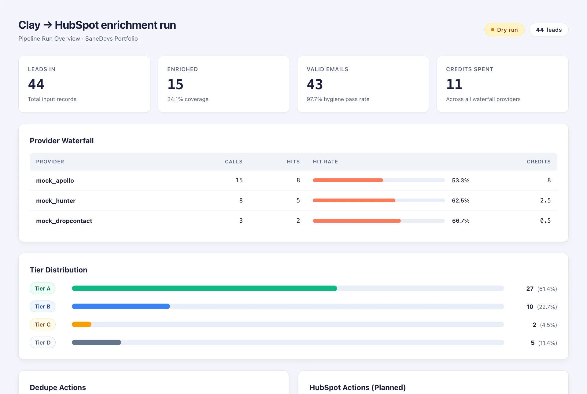
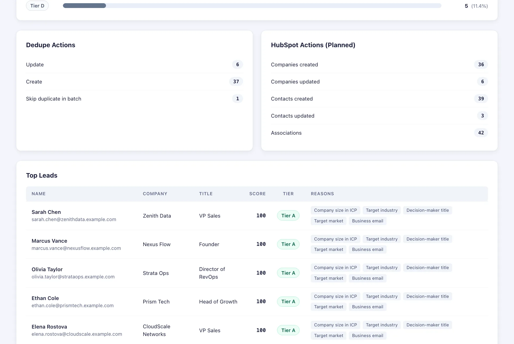

# Clay → HubSpot Lead Enrichment Pipeline

A demo built by **SaneDevs** illustrating a robust, cost-conscious lead enrichment and CRM sync pipeline. It processes leads originating from Clay (via CSV exports or HTTP webhook triggers), enriches them through a multi-provider waterfall, validates email hygiene, scores leads against Ideal Customer Profile (ICP) rules, dedupes against existing CRM data, and upserts contacts and companies into HubSpot with proper associations.






All data in `fixtures/` is fictional. Built by [SaneDevs](https://sanedevs.com).

---

## What It Does

The pipeline executes a deterministic, multi-stage workflow:

1. **Ingestion**: Reads lead records exported from a Clay table (CSV) or sent in real time via Clay's HTTP API / webhook column.
2. **Waterfall Enrichment**: Queries enrichment providers sequentially. Once required attributes are satisfied, subsequent provider calls are skipped.
3. **Data Normalization & Validation**: Cleans contact names, formats company domains, standardizes country names to ISO-2 codes, checks email syntax, flags role-based addresses (`info@`, `sales@`), flags free-mail domains (`@gmail.com`), and identifies disposable addresses.
4. **ICP Scoring**: Evaluates leads against configurable rules in `config/icp.json` (company headcount, industry, job seniority, geography, and email quality), assigning a 0–100 score and tier (`A`, `B`, `C`, `D`). Role addresses are capped at tier `C`, while invalid and disposable emails are filtered out.
5. **HubSpot Deduplication**: Matches leads against existing HubSpot records:
   - First by exact email address.
   - Then by company domain.
   - Then by fuzzy company name matching (handling spelling variations).
   - In-batch duplicates keep the most complete record and mark the duplicate to skip.
6. **Batch Upsert & Association**: Upserts companies first, then contacts, and creates associations between contacts and companies using HubSpot's CRM v3 and v4 batch APIs.

---

## Why a Waterfall Saves Credits

Data enrichment services (such as Apollo, Hunter, or Dropcontact) charge per lookup or filled attribute. Calling every provider on every lead results in redundant queries and escalating credit consumption.

A waterfall architecture runs providers in a designated priority order (e.g., cheaper or primary providers first):
- **Stops when filled**: When primary providers furnish target fields (`email`, `title`, `employees`, `industry`, `country`), downstream providers are not queried for that lead.
- **Selective filling**: Subsequent providers are called only for missing fields.
- **Predictable budget**: High-cost providers are reserved as fallback options for difficult-to-find contacts.

---

## Running Offline (Mock Mode)

The project runs completely offline by default using built-in mock providers and an in-memory HubSpot simulator seeded with test records. No external accounts or API keys are required to test the pipeline.

### 1. Dry Run
A dry run inspects the input data, runs mock enrichment, scores the leads, builds the sync plan, and outputs a summary report without making any state changes:

```bash
python3 -m clayhub run --input fixtures/clay_export.csv --dry-run
```

The run report will be generated in `out/report.md` and `out/report.json`.
The run also writes `out/report.html`.

### 2. Mock Sync
Run the pipeline against the in-memory mock HubSpot store (without `--dry-run`):

```bash
python3 -m clayhub run --input fixtures/clay_export.csv
```

---

## Running Against Real HubSpot

To connect to a live HubSpot portal:

1. Create a **Private App** in your HubSpot portal under **Settings > Integrations > Private Apps**.
2. Grant the following required scopes:
   - `crm.objects.contacts.read`
   - `crm.objects.contacts.write`
   - `crm.objects.companies.read`
   - `crm.objects.companies.write`
3. Copy your access token into an environment variable:
   ```bash
   export HUBSPOT_TOKEN="pat-na1-xxxxxxxx-xxxx-xxxx-xxxx-xxxxxxxxxxxx"
   ```
4. Run the pipeline:
   ```bash
   python3 -m clayhub run --input fixtures/clay_export.csv
   ```

When `HUBSPOT_TOKEN` is present, the pipeline uses the live HubSpot API with batch operations (chunks of 100) and automatic rate-limit backoff (honoring `Retry-After` headers on 429 and retrying 5xx server errors).

To enable live enrichment adapters, set the optional provider API keys:
```bash
export APOLLO_API_KEY="your-apollo-key"
export HUNTER_API_KEY="your-hunter-key"
```
A template is available in `.env.example`.

---

## Webhook Mode (Clay HTTP API Column)

Clay tables can trigger individual HTTP requests using an "HTTP API" or webhook action column. Clayhub can run as a local server to receive these payloads:

```bash
python3 -m clayhub serve --port 8787 --dry-run
```

The endpoint accepts `POST /clay-webhook` containing either a single row object or `{"rows": [...]}`. A sample payload can be found in `fixtures/clay_webhook.json`.

---

## Configuring the ICP (`config/icp.json`)

All scoring criteria, tier thresholds, and waterfall ordering are defined in `config/icp.json`:

```json
{
  "waterfall": ["mock_apollo", "mock_hunter", "mock_dropcontact"],
  "rules": [
    {"field": "employees", "op": "between", "value": [20, 500], "points": 30, "reason": "Company size in ICP"},
    {"field": "industry", "op": "in", "value": ["Software", "SaaS", "IT Services", "Marketing Services"], "points": 25, "reason": "Target industry"},
    {"field": "title", "op": "seniority_at_least", "value": "director", "points": 25, "reason": "Decision-maker title"},
    {"field": "country", "op": "in", "value": ["US", "GB", "CA", "AU", "DE", "NL"], "points": 10, "reason": "Target market"},
    {"field": "flags", "op": "not_contains", "value": "free_mail", "points": 10, "reason": "Business email"}
  ],
  "tiers": {"A": 80, "B": 60, "C": 40},
  "hubspot": {
    "contact_props": {
      "sd_icp_score": "score",
      "sd_icp_tier": "tier",
      "sd_enrichment_source": "sources"
    }
  }
}
```

- **Seniority ladder**: Evaluates job titles against predefined levels: `owner/founder/ceo/cxo > vp > head > director > manager > senior > ic`.
- **Custom property mapping**: Maps pipeline metadata (`score`, `tier`, `sources`) to your custom HubSpot contact properties.

---

## Running Tests

The test suite runs using Python's standard `unittest` module without external dependencies:

```bash
python3 -m unittest discover -s tests
```

---

## Limitations & Architecture Boundaries

- **Sample Adapters**: The provided Apollo and Hunter adapters are reference implementations demonstrating how to structure requests via Python's standard library `urllib`. Review each provider's respective API documentation, rate limits, and terms of service before production usage.
- **No Direct Clay API**: This demo does not call Clay's internal API directly; it operates on exported CSV files or payloads delivered by Clay's HTTP API / webhook columns.
- **Standard Library Only**: Designed to run cleanly in Python 3.11+ environments without requiring virtualenv packages or third-party dependencies.
